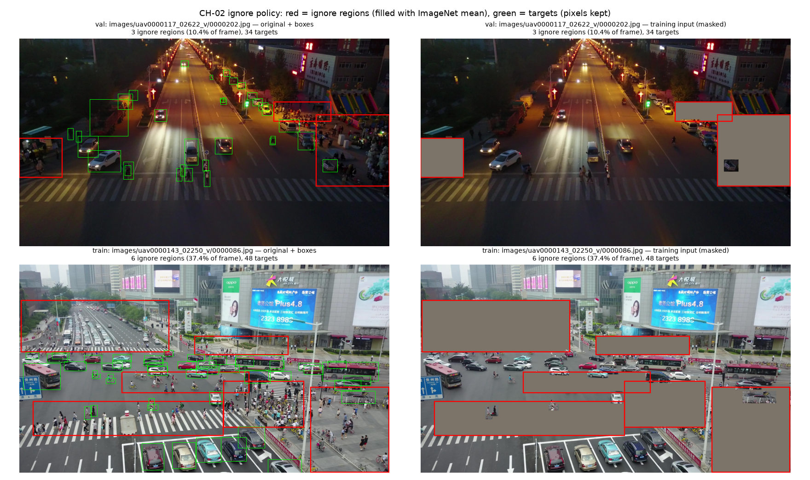
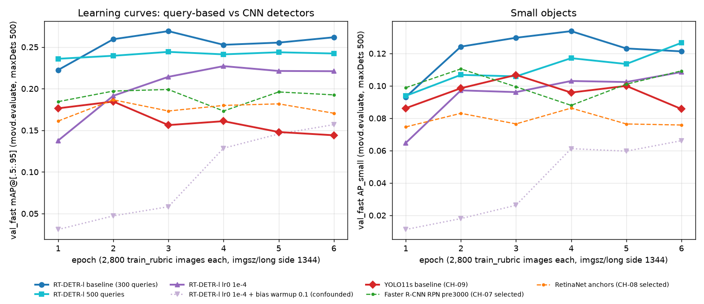

> Working draft prepared with AI assistance at committed evidence snapshot `5ec9d1f` (2026-11-09), for Marko and Nazar to review and explain in their own words. This is not a final student-authorship sign-off (G10). AP values are fractions. CH-10, CH-12 and CH-13 evidence is integrated; CH-14 final training/submissions and CH-16/G10 sign-off remain pending.

## 1. Introduction and objectives

The task is frame-level detection in aerial video from VisDrone: locate objects and assign one of eight merged classes (person, bicycle, car, van, truck, tricycle, bus, motor). The completed experiments compare proposal-based, dense anchor-based, anchor-free and query-based detectors under a shared validation protocol. Tracking and temporal models are outside this comparison. The objective is to measure accuracy, small-object performance and inference cost before choosing the final pipeline. [Task and label mapping](configs/protocol.json).

## 2. Dataset and exploratory analysis (CH-02, CH-06)

The supplied split separates clips, avoiding leakage from neighbouring video frames. EDA counts targets separately from repeated crowd annotations. Cars dominate train targets (45.71%), while people account for 44.08% of validation targets; bus has only 264 validation boxes. This makes per-class AP essential alongside the aggregate. Small objects are 24.91% of train targets in original pixels. At the frozen resize, 8.26% fall below 16 pixels in square-root area, supporting retention of a high input resolution. [EDA numbers](results/ch-06-eda/key_numbers.json).

Adjacent train frames share 99.5% of tracks. The fixed sample retains 98.6% of train tracks with a median gap of eight frames, reducing redundancy while covering every clip. It is not uniform sampling of all objects: scene density and class mix vary by sequence. This motivates size/density breakdowns and conservative conclusions about rare classes. [Sequence tables](results/ch-06-eda/tables/per_sequence.csv).

| Split | Clips | Frames | Target boxes | Unique ignore regions |
|---|---:|---:|---:|---:|
| Train | 56 | 24,201 | 1,105,516 | 63,843 |
| Validation | 7 | 2,846 | 114,132 | 3,995 |
| Test | 48 | 3,811 | Unknown (unlabelled) | Unknown |

Source: [CH-06 key numbers](results/ch-06-eda/key_numbers.json), `split_overview`; [class/size/density/sequence tables](https://github.com/Marko-Zenon/Multiple-Object-Video-Detection/tree/c3873d2/results/ch-06-eda/tables).

## 3. Preprocessing and ignored regions (CH-02, CH-04, CH-09)

Training excludes crowd boxes from targets and fills ignored pixels with the ImageNet mean, preserving pixels inside labelled target boxes. This reduces visible unlabelled content but is a masking heuristic, not explicit loss suppression. Evaluation keeps the supplied crowd annotations unchanged: each ignore region has a copy for every class, so detections there can be ignored by the COCO evaluator. Simply dropping these regions would count some valid ignored detections as false positives. [Policy and verification](results/ch-02-protocol/data_facts.json); [implementation](movd/data.py).

The figure preserves labelled targets where they overlap ignored regions; copied unchanged from the [pipeline check](results/ch-02-protocol/figures/ignore_masking_check.png).

## 4. Shared experimental protocol (CH-02, CH-03)

The [frozen protocol](configs/protocol.json) prevents changes in data, resolution or evaluation from being mistaken for model gains. Training uses 50 evenly spaced frames per train clip: 2,800 frames × six epochs = 16,800 images seen, seed 42, horizontal flips and AMP. Torchvision uses batch two; YOLO11s and RT-DETR use batch one. Torchvision keeps aspect ratio with a 1344-pixel maximum side; YOLO letterboxes at imgsz 1344. RT-DETR instead stretches to a 1344 square in its adapter, an important limitation of geometric comparability. Equal images seen does not mean equal compute.

Curves and final-epoch variant selection use val_fast (714 frames); headline metrics use all 2,846 val_full frames. [The shared evaluator](movd/evaluate.py) reports COCO AP over IoU 0.50:0.05:0.95, AP50/75 and original-pixel small/medium/large bins, after a global top-500 detection cap. Legacy notebook results used a different budget, resolution and crowd policy and are excluded.

[Evaluator sanity checks](results/ch-03-evaluator/sanity.json) give mAP 1.0000 for ground truth as predictions on val_full. On val_fast, adding ignored-region detections preserves mAP 1.0000; removing crowd annotations lowers it to 0.8667. A shifted-label control collapses AP. These checks validate the implementation, not equivalence to Kaggle’s hidden scorer.

## 5. Two-stage detector: Faster R-CNN (CH-07)

The COCO-pretrained ResNet-50-FPN v2 proposal stage identifies candidate regions; the second stage classifies and refines them. Increasing training RPN pre-NMS candidates from 2,000 to 3,000 tested whether more candidates help tiny targets. Raising the RoI positive fraction from 0.25 to 0.50 separately tested greater foreground sampling. The RPN variant won final-epoch val_fast selection: its small-object AP improved, with lower large-object AP and throughput. The RoI change reduced overall AP. [Controlled protocol](results/ch-07-frcnn/protocol.md).

[Failure examples](results/ch-07-frcnn/failure_analysis.md) show tiny-target misses, car/van confusion and dense-scene misses. These illustrate localization, class ambiguity and missed neighbours; they do not quantify how much each mechanism contributes.

### Verified six-epoch results

| Run | mAP | AP50 | AP75 | AP_S | AP_M | AP_L | FPS | Latency ms |
|---|---:|---:|---:|---:|---:|---:|---:|---:|
| [frcnn_baseline](results/frcnn_baseline/metrics.json) | 0.1873 | 0.3808 | 0.1604 | 0.0913 | 0.1779 | 0.3452 | 18.69 | 53.50 |
| [frcnn_rpn_pre3000](results/frcnn_rpn_pre3000/metrics.json) | 0.1893 | 0.3847 | 0.1614 | 0.1083 | 0.1868 | 0.3107 | 14.85 | 67.35 |
| [frcnn_roi_pos50](results/frcnn_roi_pos50/metrics.json) | 0.1814 | 0.3643 | 0.1553 | 0.1004 | 0.1763 | 0.3109 | 17.48 | 57.19 |

Sources: each linked `metrics.json` → `val_full.metrics`; sibling `speed.json` → `inference`. All three: RTX 5070 Laptop GPU, Windows 11, Python 3.12.14, torch 2.14.1+cu130, torchvision 0.29.1+cu130, COCO_V1 initialization. Speed uses 10 warmups and 30 batch-one GPU-resident frames, including detector transforms and NMS; decoding and host transfer excluded. This is detector throughput, not end-to-end video FPS. [Protocol, runtimes and weight checksum](results/ch-07-frcnn/protocol.md).

### Per-class AP on val_full

| Class | Baseline | RPN pre3000 | RoI pos50 |
|---|---:|---:|---:|
| person | 0.2440 | 0.2450 | 0.2510 |
| bicycle | 0.1608 | 0.1950 | 0.1419 |
| car | 0.3774 | 0.3756 | 0.3902 |
| van | 0.2128 | 0.1725 | 0.2075 |
| truck | 0.1442 | 0.1589 | 0.1245 |
| tricycle | 0.1800 | 0.1981 | 0.1929 |
| bus | 0.0471 | 0.0569 | 0.0340 |
| motor | 0.1325 | 0.1125 | 0.1087 |

Source: same run metric files → `val_full.per_class[].AP`. Density-bin AP is stored under `val_full.density`; six epoch points under each run’s `curve.json` → `val_fast`.

## 6. One-stage anchor-based detector: RetinaNet (CH-08)

RetinaNet predicts anchors directly without a proposal stage. The completed runs compare COCO-pretrained ResNet-50-FPN v2, smaller anchor scales motivated by target sizes, and focal gamma reduced from 2.0 to 1.5 with alpha fixed at 0.25. Focal loss reduces the influence of easy negatives in dense classification. [Configurations and experiment rationale](results/ch-08-retina/preflight.md).

The anchor variant won final-epoch val_fast selection. On val_full, overall AP improved but AP_small fell, so the smaller-anchor hypothesis did not deliver a small-object gain in this run. The focal change lowered overall AP while modestly improving AP_small. Selected Faster R-CNN remained ahead overall and on small objects; selected RetinaNet led on large objects. [Results and caveats](results/ch-08-retina/results.md).

| Run | mAP | AP50 | AP75 | AP_S | AP_M | AP_L |
|---|---:|---:|---:|---:|---:|---:|
| [retina_baseline](results/retina_baseline/metrics.json) | 0.1623 | 0.3137 | 0.1458 | 0.0780 | 0.1492 | 0.3045 |
| [retina_anchors](results/retina_anchors/metrics.json) | 0.1693 | 0.3465 | 0.1446 | 0.0754 | 0.1528 | 0.3223 |
| [retina_focal_gamma15](results/retina_focal_gamma15/metrics.json) | 0.1524 | 0.3006 | 0.1362 | 0.0832 | 0.1432 | 0.3002 |

## 7. One-stage anchor-free detector: YOLO11 (CH-09, CH-10)

The COCO-pretrained YOLO11s baseline uses the same masked training export, with class and coordinate adapters checked against the project evaluator. It completed the full budget at imgsz 1344, batch one and AMP on Marko’s RTX 3050. Native Ultralytics training metrics are not substituted for project AP. [Configuration, losses and export checks](results/yolo_baseline_marko_3050/README.md).

| Run | mAP | AP50 | AP75 | AP_S | AP_M | AP_L |
|---|---:|---:|---:|---:|---:|---:|
| [yolo_baseline_marko_3050](results/yolo_baseline_marko_3050/metrics.json) | 0.1439 | 0.2925 | 0.1192 | 0.0866 | 0.1434 | 0.2555 |

The project val_fast curve peaks at epoch two and falls by the final epoch, although training losses continue downward. This divergence does not establish a cause; the reported baseline uses the final checkpoint as specified before training. [Curve and failures](results/yolo_baseline_marko_3050/curve.json).

### Completed anchor-free tuning (CH-10)

CH-10 reran the baseline on RTX 5070, added a stride-4 P2 head after a compatibility smoke, and tested imgsz 1600 as an approved resolution exception. The first P2 smoke exposed missing class-name weight transfer; that failed initialization is retained, and the full run uses the corrected initialization. No loss/assignment fallback was needed. [Transfer and experiment evidence](results/ch-10-yolo-tuning/analysis.md).

| Run | mAP | AP50 | AP75 | AP_S | AP_M | AP_L |
|---|---:|---:|---:|---:|---:|---:|
| [yolo_baseline_5070](results/yolo_baseline_5070/metrics.json) | 0.1502 | 0.3079 | 0.1252 | 0.0949 | 0.1520 | 0.2542 |
| [yolo_p2](results/yolo_p2/metrics.json) | 0.1626 | 0.3063 | 0.1510 | 0.0790 | 0.1483 | 0.3124 |
| [yolo_imgsz1600](results/yolo_imgsz1600/metrics.json) | 0.1710 | 0.3397 | 0.1482 | 0.0894 | 0.1760 | 0.2748 |

The predeclared final-epoch val_fast rule selected imgsz1600; P2 was best at the fixed 1344 size. Higher resolution raises compute, so the 1600 run is reported separately from the fixed-resolution family comparison. P2 increased overall AP but lowered AP_small; the small-object-head hypothesis was not supported at this budget. The baseline replicate differs by 0.0063 val_full mAP and 0.0092 val_fast mAP, combining hardware and nondeterministic variation rather than estimating a confidence interval. [Selection](results/ch-10-yolo-tuning/selection.json); [size/density breakdowns](results/ch-10-yolo-tuning/density.csv).

Dense-bin and tiny-target results do not establish a single mechanism: scene/class mix differs, the new P2 branch has a short training budget, and the same tiny misses/class confusions persist in qualitative cases. [Failure evidence](results/ch-10-yolo-tuning/failures.csv).

## 8. Query-based detector: RT-DETR (CH-11)

COCO-pretrained RT-DETR-l completed the shared budget at batch one without an out-of-memory failure on the RTX 5070, resolving feasibility gate G9. It uses bipartite matching and a fixed set of query predictions instead of NMS. [Run and memory evidence](results/ch-11-rtdetr/analysis.md).

| Run | mAP | AP50 | AP75 | AP_S | AP_M | AP_L |
|---|---:|---:|---:|---:|---:|---:|
| [rtdetr_baseline](results/rtdetr_baseline/metrics.json) | 0.2577 | 0.4775 | 0.2392 | 0.1296 | 0.2246 | 0.4538 |
| [rtdetr_q500](results/rtdetr_q500/metrics.json) | 0.2389 | 0.4556 | 0.2145 | 0.1281 | 0.2140 | 0.4027 |
| [rtdetr_lr1e4_wb0](results/rtdetr_lr1e4_wb0/metrics.json) | 0.2179 | 0.4261 | 0.1956 | 0.1015 | 0.2120 | 0.3693 |
| [rtdetr_lr1e4](results/rtdetr_lr1e4/metrics.json) | 0.1560 | 0.3066 | 0.1412 | 0.0639 | 0.1556 | 0.2818 |

The baseline val_fast curve exceeds every completed CNN curve at each matched epoch, starting at epoch one; it peaks at epoch three. This is evidence about pretrained fine-tuning under this budget, not a general claim that transformers converge faster. Increasing queries from 300 to 500 hurt overall AP and did not improve AP_small. The corrected lr0 1e-4 run also hurt performance. The earlier lr0 1e-4 run additionally changed bias warmup and is **confounded, retained for transparency, and invalid as isolated learning-rate tuning evidence**. [Curves](results/ch-11-rtdetr/curves.csv); [confounded-run record](results/rtdetr_lr1e4/README.md).

The baseline leads the completed runs on each size bucket and density bin, but small-object AP remains much lower than large-object AP. Density bins differ in image/class mix and cannot establish a causal effect of crowding. [Size and density evidence](results/ch-11-rtdetr/density.csv).

## 9. Cross-family comparison and finalist selection (CH-12)

| Run | mAP | AP50 | AP75 | AP_S | AP_M | AP_L |
|---|---:|---:|---:|---:|---:|---:|
| [frcnn_rpn_pre3000](results/frcnn_rpn_pre3000/metrics.json) | 0.1893 | 0.3847 | 0.1614 | 0.1083 | 0.1868 | 0.3107 |
| [retina_anchors](results/retina_anchors/metrics.json) | 0.1693 | 0.3465 | 0.1446 | 0.0754 | 0.1528 | 0.3223 |
| [yolo_p2](results/yolo_p2/metrics.json) | 0.1626 | 0.3063 | 0.1510 | 0.0790 | 0.1483 | 0.3124 |
| [rtdetr_baseline](results/rtdetr_baseline/metrics.json) | 0.2577 | 0.4775 | 0.2392 | 0.1296 | 0.2246 | 0.4538 |

CH-12 selected **RT-DETR-l baseline settings**. Its val_full lead over selected Faster R-CNN is 0.0683 mAP, about 10.8 times the one-pair baseline spread, and it wins all 27 secondary comparisons (five other COCO metrics and four density bins against each rival family). This supports the recorded selection under this protocol; it is not a significance test. The 1600 YOLO exception and confounded RT-DETR LR run are excluded from the primary comparison. [Decision](results/ch-12-comparison/decision.md); [selection record](results/ch-12-comparison/selection.json).

The frozen [final training plan](configs/runs/final.json) keeps 300 queries, imgsz1344, six epochs and baseline optimizer/augmentation settings, but uses every fourth train frame: 6,072 frames and 36,432 images seen. This is a plan for Nazar’s CH-14, not evidence that training has completed. The rubric RT-DETR checkpoint is the recorded fallback; final submission choice still requires CH-14 validation.

### Device and benchmark boundaries

Marko’s original YOLO11s FP32 result remains **36.37 FPS / 27.49 ms per image on RTX 3050 Laptop GPU**. A historical CH-11 same-session RTX 5070 measurement was YOLO 64.21 versus RT-DETR 10.60 FPS. Neither is interchangeable with a later session.

CH-12 retimed all family representatives on one RTX 5070 Laptop GPU: FP32, preloaded BGR host arrays, transfer, model preprocessing, inference and postprocessing included; disk I/O excluded. The table uses medians of three interleaved rounds. It supports a same-session comparison; native GPU-resident torchvision timings shown in section 5 remain a separate scope.

| Run | Common-scope FPS, RTX 5070 |
|---|---:|
| frcnn_rpn_pre3000 | 9.10 |
| retina_anchors | 6.29 |
| yolo_baseline_marko_3050 | 75.24 |
| yolo_p2 | 55.41 |
| yolo_imgsz1600 | 49.67 |
| rtdetr_baseline | 13.92 |

Source: [common-scope benchmark and checkpoint hashes](results/ch-12-comparison/speed_same_session/summary.json). RT-DETR leads accuracy while YOLO leads throughput; Faster R-CNN and RetinaNet are slower than RT-DETR in this common scope. Resize geometry still differs between models, and these measurements are not full disk-to-video-system FPS.

## 10. Completed inference tuning (CH-13), final training pending (CH-14)

CH-13 used one fixed, hash-identified CH-11 RT-DETR checkpoint without retraining. Nineteen predeclared configurations (the reference plus eighteen changes) were evaluated on val_fast, followed by two recorded combinations; only the reference, adopted single changes and chosen stack were evaluated on val_full. Larger input sizes, confidence/top-k changes, WBF, multiscale and a two-model ensemble had neutral/negative or insufficient gains under the selection rule. Failed changes remain in the [complete comparison](results/ch-13-inference/comparison.csv).

| Run | mAP | AP50 | AP75 | AP_S | AP_M | AP_L |
|---|---:|---:|---:|---:|---:|---:|
| [ref](results/ch-13-inference/runs/val_full/ref/metrics.json) | 0.2577 | 0.4775 | 0.2392 | 0.1296 | 0.2246 | 0.4538 |
| [flip_nms06](results/ch-13-inference/runs/val_full/flip_nms06/metrics.json) | 0.2660 | 0.4941 | 0.2472 | 0.1345 | 0.2302 | 0.4622 |
| [tile_nms05](results/ch-13-inference/runs/val_full/tile_nms05/metrics.json) | 0.2644 | 0.4991 | 0.2384 | 0.1425 | 0.2367 | 0.4404 |
| [combo_flip_tile_nms05](results/ch-13-inference/runs/val_full/combo_flip_tile_nms05/metrics.json) | 0.2696 | 0.5069 | 0.2453 | 0.1467 | 0.2375 | 0.4502 |

The frozen [inference config](configs/runs/final_inference.json) combines full frame, horizontal flip and four overlapping tiles: six passes at 1344, class-wise merge NMS IoU0.5, then global top500. On this rubric checkpoint, AP_small rises from 0.1296 to 0.1467; AP_large falls from 0.4538 to 0.4502, and the densest bin slips from 0.3679 to 0.3614. The 500 cap binds on 2,840 of 2,846 frames, so improvement is not uniform. [Analysis and limitations](results/ch-13-inference/analysis.md).

Same-session RTX 5070 FP32 pipeline speed falls from **13.68 FPS / 73.11 ms** to **2.26 FPS / 442.41 ms**. Preloaded-frame timing includes all passes and CPU decode/merge, excluding disk I/O. The projected time for 3,811 test frames is 28.1 minutes; this is an estimate, not a completed test run. [Reference timing](results/ch-13-inference/speed/ref.json); [selected timing](results/ch-13-inference/speed/combo_flip_tile_nms05.json).

The validation CSV round-trip initially exceeds its strict tolerance because the writer clips out-of-frame boxes. Applying the same clipping before comparison gives exactly zero difference and unchanged rounded mAP; the discrepancy is documented, not hidden. [Clipping check](results/ch-13-inference/roundtrip_clipping_check.json).

**TODO CH-14 (Nazar):** Supply final training/data-strategy validation, test/submission receipts, public scores and final selections. CH-13 gains on the rubric checkpoint are not final-model or Kaggle results.

## 11. Kaggle submission and selection (CH-05, CH-14)

The submission writer emits original-pixel `class score x y width height` groups, classes 0–7, one row per test image and at most 500 detections. Validation and a lossless prediction round-trip precede upload. The first accepted upload below demonstrates the pipeline; it is below the competition baseline. **TODO CH-14:** Record final uploads and the two final selections using internal validation.

| Submission | val_full mAP | Kaggle public score | Status |
|---|---:|---:|---|
| Faster R-CNN RPN pre3000, epoch 6 | 0.1893354654 | 0.2011538266 | Accepted; below public baseline 0.2216324580 |

Source: [append-only submissions log](results/submissions.csv), [validation receipt](results/ch-05-submission/frcnn_rpn_pre3000_e6_test/validation.txt), [lossless real round-trip](results/ch-05-submission/roundtrip_frcnn_rpn_pre3000_e6_lossless.json). Test: 3,811 rows and 261,940 detections. Final uploads and selections remain CH-14 work. Official Close is 2026-11-10 21:55 UTC / 23:55 Europe/Kyiv; see [independent verification](docs/report-support/deadline.md).

## 12. Limitations and reproducibility (CH-16)

Each configuration has one seed; CH-10 adds one same-config replicate on different hardware. Its spread is not a multi-seed uncertainty estimate, and small AP differences have no established significance. CUDA nondeterminism, correlated video frames, subset training, sequence/class shifts and scarce classes limit generalization. Repeated tuning on the same validation split can also favor that split. The common budget controls images seen, not optimizer updates, model size or compute. Resizing and benchmark scopes differ as described above. Constant-fill ignore masking and unknown equivalence to Kaggle’s hidden scorer remain limitations.

CH-01/04 established the checked data/environment and resumable training pipeline. Pinned [dependencies](requirements.txt), per-run configs, curves, hardware/runtime records and weight checksums support reproduction. Use the [Faster R-CNN protocol](results/ch-07-frcnn/protocol.md), [YOLO GPU runbook](results/ch-09-yolo/GPU_RUNBOOK.md) and [RT-DETR evidence commands](results/ch-11-rtdetr/make_evidence.py); training is outside the notebook. This documentation task did not rerun models or perform the final clean-environment audit. CH-16 remains blocked by CH-14 and student authorship sign-off; the independent [preflight audit](docs/report-support/preflight-audit.md) does not claim CH-16 completion.

Collaboration uses separate branches, pushed ownership claims and short notebook locks. CH-09 artifacts were transferred with hash verification and independently re-evaluated before integration; [PR #10 closeout](https://github.com/Marko-Zenon/Multiple-Object-Video-Detection/pull/10) records exact reproduction. [CH-15/M1](https://github.com/Marko-Zenon/Multiple-Object-Video-Detection/pull/9) established the Pages scaffold. This draft changes neither task ownership nor the deployment infrastructure.

## 13. Discussion — student authored

The observations above describe measured outcomes and limitations. Causal explanations for tuning failures were not isolated experimentally.

**TODO final student conclusions:** Nazar and Marko must review the discussion in their own words, connect it to the final selection, and confirm authorship under G10.

## 14. Conclusions — student authored

**TODO final student conclusions:** After CH-14 and final audit, state the selected pipeline, evidence-supported conclusions, unsuccessful hypotheses and remaining limitations in Nazar and Marko’s own words.

## 15. References

Model references: [Faster R-CNN](https://arxiv.org/abs/1506.01497), [FPN](https://arxiv.org/abs/1612.03144), [RetinaNet / focal loss](https://arxiv.org/abs/1708.02002), [RT-DETR](https://arxiv.org/abs/2304.08069), [VisDrone](https://arxiv.org/abs/2001.06303), and [COCO evaluation](https://cocodataset.org/#detection-eval). Implementation and exact weight provenance: [torchvision runs](results/ch-07-frcnn/protocol.md), [YOLO11s](results/yolo_baseline_marko_3050/README.md), [RT-DETR](results/ch-11-rtdetr/analysis.md), [Ultralytics version/license notices](README.md). Ultralytics is pinned to 8.4.207 and used under AGPL-3.0. [Official assignment](https://www.kaggle.com/competitions/multiple-object-video-detection-hw-2-ucu-ai-2026/overview); [deadline verification](docs/report-support/deadline.md).

## Evidence and figure inventory

The existing ignore-mask image is unchanged. Other figures link directly to committed results; no experiment artifacts were regenerated. [EDA figure sources](https://github.com/Marko-Zenon/Multiple-Object-Video-Detection/tree/81ddfee/results/ch-06-eda/figures), [Faster R-CNN failures](results/ch-07-frcnn/failure_cases.csv), [RetinaNet curves](results/ch-08-retina/figures/val_fast_curves.png), [YOLO failures](results/yolo_baseline_marko_3050/failure_cases.csv), and [RT-DETR failures](results/rtdetr_baseline/failure_cases.csv) retain provenance.

[Numerical traceability and validation](docs/report-support/validation.md) covers this draft. Smoke/CPU plumbing runs and legacy v0 remain excluded from headline comparisons. Historical UNKNOWN deadline/daily-limit fields in configs/protocol.json are stale; current operational evidence does not change the frozen experiment settings.
