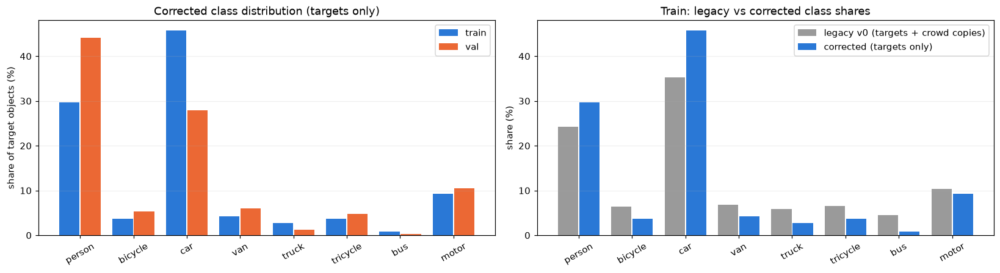
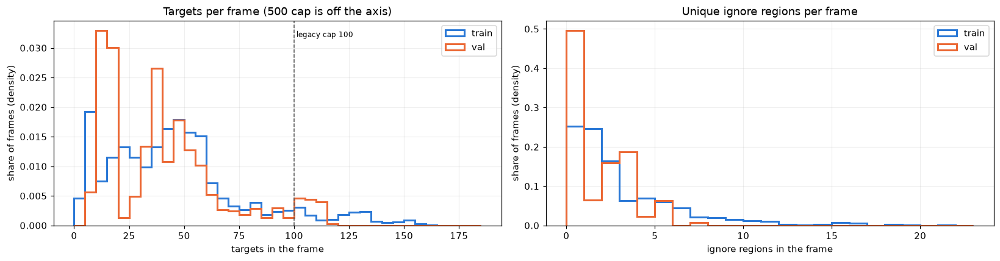
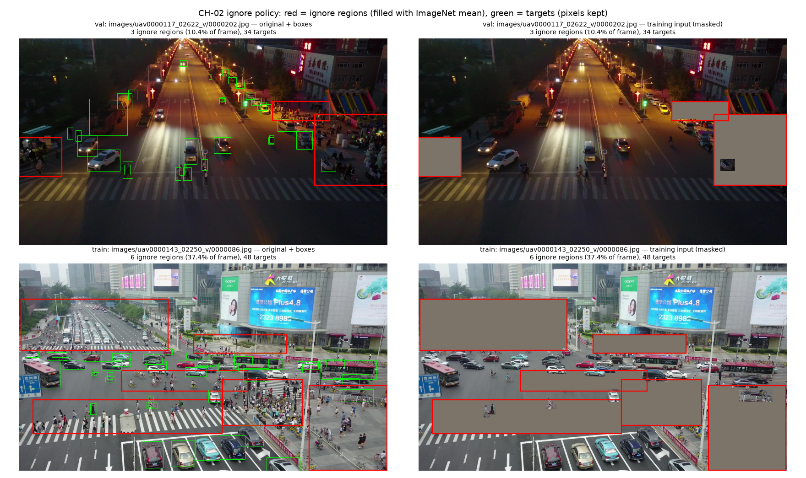

## 1. Task and Dataset

Our task was to detect objects in drone videos from the VisDrone dataset. For every frame, the model had to find each object, choose its class and return a bounding box. We worked with eight classes: person, bicycle, car, van, truck, tricycle, bus and motor.

The main difficulties were small objects, dense scenes, occlusion and visually similar classes. The dataset contains:

| Split | Clips | Frames | Target boxes | Ignore regions |
|---|---:|---:|---:|---:|
| Train | 56 | 24,201 | 1,105,516 | 63,843 |
| Validation | 7 | 2,846 | 114,132 | 3,995 |
| Test | 48 | 3,811 | Unknown | Unknown |

Our EDA showed that the classes are imbalanced and almost 25% of training objects are small. Some frames also contain hundreds of objects. Adjacent video frames are very similar, so using all of them would add a lot of computation without the same increase in information. For the common model comparison, we selected 50 frames from each training clip, or 2,800 images in total. This subset retained 98.6% of the training tracks.





## 2. Preprocessing and Evaluation

We used an input size of 1344 because small people and vehicles can become only a few pixels at lower resolutions. The model families handled resizing differently. Faster R-CNN and RetinaNet kept the aspect ratio, YOLO used letterboxing, and our RT-DETR adapter resized inputs to a 1344 × 1344 square.

The annotations also contain ignore regions. We did not use them as normal targets. Instead, we filled their pixels with the ImageNet mean value. If an ignore region overlapped a labelled object, we kept the object pixels. The implementation and visual check are available in [the preprocessing evidence](results/ch-02-protocol/data_facts.json).



For the main comparison, we fixed the training subset, six epochs, seed, input size and evaluation code. We used two validation sets:

- `val_fast`: 714 frames used for quick checks;
- `val_full`: all 2,846 validation frames used for final comparisons.

`val_fast` is part of `val_full`, not an independent dataset. This made experiments faster, but repeated tuning could over-fit the validation frames.

Our main metric was COCO `mAP@[0.50:0.95]`. It averages precision across the eight classes and IoU thresholds from 0.50 to 0.95. We also measured AP50, AP75, AP for different object sizes and inference speed. The evaluator kept at most 500 predictions per frame.

## 3. Model Comparison

We trained four detector families under the common protocol.

- **Faster R-CNN** is a two-stage detector. It first creates region proposals and then classifies and refines them. Increasing the number of RPN proposals improved small-object AP but reduced speed.
- **RetinaNet** is a one-stage anchor-based detector that uses focal loss. Modified anchors improved total mAP, but did not improve small-object AP as expected.
- **YOLO11s** is a fast anchor-free detector. We tested a P2 detection head and a 1600-pixel input. The higher resolution gave the best YOLO result, but it was outside the common 1344-pixel comparison.
- **RT-DETR-l** uses transformer queries to predict objects. Increasing the number of queries from 300 to 500 and changing the learning rate did not help, but its baseline was still clearly the strongest.

| Model | val_full mAP | AP50 | AP_S | Common-scope FPS |
|---|---:|---:|---:|---:|
| Faster R-CNN RPN pre3000 | 0.1893 | 0.3847 | 0.1083 | 9.10 |
| RetinaNet modified anchors | 0.1693 | 0.3465 | 0.0754 | 6.29 |
| YOLO11s P2 | 0.1626 | 0.3063 | 0.0790 | 55.41 |
| **RT-DETR-l baseline** | **0.2577** | **0.4775** | **0.1296** | 13.92 |

RT-DETR gave the best accuracy, while YOLO was much faster. This result only describes our dataset and training budget; it does not mean that transformer detectors are always better. Based on this comparison, we selected RT-DETR-l for the remaining experiments. Detailed runs and curves are stored in [the family comparison](results/ch-12-comparison/decision.md).

### Faster R-CNN failure cases

We inspected incorrect Faster R-CNN predictions and found three common cases. First, it missed tiny objects that occupied only a few pixels. Second, it sometimes confused cars with vans because they look similar from a drone view. Third, it missed objects in dense scenes where many boxes overlap. Examples are stored in [the failure analysis](results/ch-07-frcnn/failure_analysis.md).

## 4. Improving RT-DETR

### Inference tuning

We first tried to improve RT-DETR without retraining it. We tested input sizes, confidence thresholds, top-k limits, weighted box fusion, multiscale inference, horizontal-flip TTA, overlapping tiles and an early two-model ensemble.

The best configuration combined the full frame, its horizontal flip and four overlapping tiles. Each frame was processed six times at 1344. We merged the predictions using class-wise NMS at IoU 0.5 and kept the top 500 detections.

| Inference configuration | mAP | AP50 | AP_S | AP_L |
|---|---:|---:|---:|---:|
| Single pass | 0.2577 | 0.4775 | 0.1296 | 0.4538 |
| Horizontal flip | 0.2660 | 0.4941 | 0.1345 | 0.4622 |
| Overlapping tiles | 0.2644 | 0.4991 | 0.1425 | 0.4404 |
| **Flip + tiles** | **0.2696** | **0.5069** | **0.1467** | 0.4502 |

The selected pipeline helped small objects, but reduced speed from 13.68 FPS to 2.26 FPS. Processing the full test set took around 28–29 minutes.

### Final training

Next, we trained RT-DETR on every fourth frame from all 56 training clips, giving 6,072 frames. The last checkpoint over-fitted and reached only 0.2372 mAP with our inference pipeline. Because we saved every epoch, we found that epoch 1 was much better: it reached 0.2860 on `val_full` and 0.2774301362 on Kaggle.

This showed that more epochs were not automatically better. The model quickly learned useful information and then started to memorize the similar training scenes. We therefore focused on early checkpoints, model soups and stronger augmentation.

We also used information from neighbouring video frames. If a detection was supported by nearby frames, we increased its confidence. Removing boxes cut by tile borders also gave a small improvement. Together with checkpoint averaging, these changes produced the E6 system, which scored 0.2947349001 publicly. A later 0.75/0.25 checkpoint average reached 0.2974 on `val_full` and 0.2960489045 on Kaggle. We called this model C1.

### Final model

For the last training run, we started from the C1 weights. We added mosaic, scale, translation, HSV and horizontal-flip augmentation. We also used AdamW with cosine learning-rate decay and kept BatchNorm statistics frozen.

The model improved until epoch 3, which reached 0.2916 in the single-view check compared with 0.2882 for the starting weights. Later epochs became worse again. We averaged the epoch-3 weights with C1 using equal weights:

$$
W_{final}=0.5W_{C1}+0.5W_{epoch3}.
$$

This final WiSE-FT model improved `val_full` by 0.0148 and the validation subset with width up to 1920 by 0.0137. However, it performed worse on two very wide validation clips and failed our original selection rule. The test set had no frames wider than 1920, so we recorded an exception and uploaded it as an additional test of the resolution hypothesis. We did not change or hide the failed rule.

The result was much stronger than expected: the public Kaggle score increased to **0.3470602874**.

## 5. Kaggle Results

Every submission contained all 3,811 test IDs in the required order and no more than 500 detections per frame. We checked each final CSV using both the project validator and an independent validator.

| Submission | Kaggle public score |
|---|---:|
| Faster R-CNN | 0.2011538266 |
| RT-DETR flip + tiles | 0.2328849249 |
| Early final-training checkpoint | 0.2774301362 |
| E6 | 0.2947349001 |
| C1 | 0.2960489045 |
| **Final WiSE-FT model** | **0.3470602874** |

The final score was 0.0510113829 higher than our previous best. We selected `opt12_c2_wiseft_test.csv` as the main submission and kept C1 as the second selection. All files, hashes and public scores are recorded in [the submission log](results/submissions.csv) and [the final handoff](results/opt-12-regularized-finetune/HANDOFF.md).

## 6. Reproduction

The code was run with Python 3.12 and the pinned packages from `requirements.txt`. From the repository root, the main steps are:

```bash
python -m pip install -r requirements.txt
python scripts/check_dataset.py --root <dataset-path>
python scripts/opt12_train.py --config configs/runs/opt12_reg_ft.json --device 0
python scripts/opt12_morning.py baseline
python scripts/opt12_morning.py select
python scripts/opt12_morning.py cache wstar test
python scripts/opt12_morning.py csv C2
python scripts/opt12_morning.py rebuild C2
```

Before running these commands, the dataset, C1 source checkpoint and protected C1 caches must be restored at the paths and hashes recorded in [OPT-12 HANDOFF](results/opt-12-regularized-finetune/HANDOFF.md). The final commands create `submissions/opt12_c2_wiseft_test.csv`, run both validators and rebuild the file to check that its SHA256 is identical.

## 7. Discussion and Limitations

Checkpoint averaging worked better than our simple ensembles with older or similar models. The new epoch-3 model was stronger on some clips, while C1 was more stable. Their average kept useful properties from both without adding inference cost.

The project also showed a problem with our validation data. Two very wide clips strongly affected `val_full`, while the test frames were at most 1920 pixels wide. The width-matched subset predicted the final Kaggle improvement better. In future work, we would create validation splits by resolution and scene type before tuning.

There are several limitations. Most models were trained with one seed, we tested many ideas on the same validation frames, and the final candidate required a recorded exception to our original rule. We also saw public leaderboard scores during development. Therefore, the final score is not a completely independent estimate of generalization. The final pipeline is also slow: 2.26 FPS was acceptable for this test set, but not for real-time use.

## 8. Conclusion

RT-DETR-l was the most accurate model family in our experiments. The final system combined regularized fine-tuning, a 50/50 weight average with C1 and multi-pass inference. It achieved a Kaggle public score of **0.3470602874**. Longer training was harmful on similar video frames, while checkpoint averaging, stronger augmentation and validation at test-like resolutions helped the final result.

## References

[Faster R-CNN](https://arxiv.org/abs/1506.01497); [FPN](https://arxiv.org/abs/1612.03144); [RetinaNet](https://arxiv.org/abs/1708.02002); [RT-DETR](https://arxiv.org/abs/2304.08069); [VisDrone](https://arxiv.org/abs/2001.06303); [COCO evaluation](https://cocodataset.org/#detection-eval). Ultralytics was pinned to version 8.4.207.

## AI Assistance Declaration

AI assistants supported planning, code review and automation of repeated experiment steps, documentation checks and language editing. We selected the experiment directions, ran and verified the experiments, made the Kaggle uploads and reviewed the final report. We are responsible for the final interpretation and submitted work.
